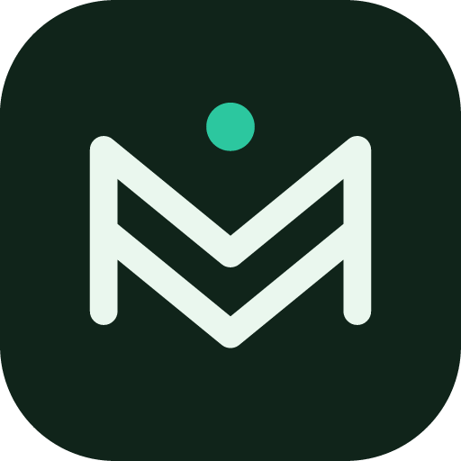
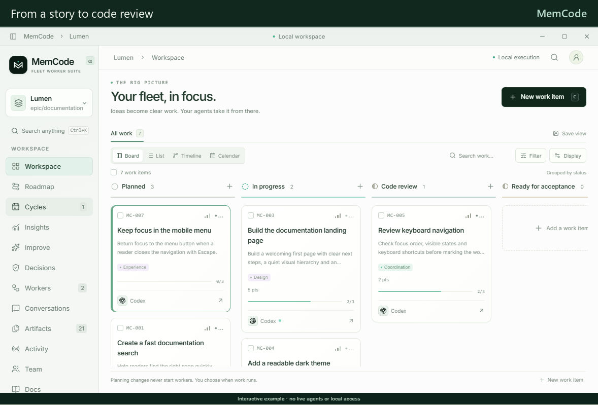

<p align="center"></p>
<h1 align="center">MemCode</h1>
<p align="center"><strong>One board for the coding agents you already use.</strong></p>
<p align="center"><a href="https://www.memtrace.io/memcode#downloads">Download the desktop beta</a> &nbsp;·&nbsp; <a href="https://www.memtrace.io/memcode#walkthrough">Try the interactive demo</a> &nbsp;·&nbsp; <a href="https://www.memtrace.io/docs/memcode/getting-started">Getting started</a></p>

Give Claude Code a bug to fix while Codex works on the next feature and you review what Cursor changed. Each story keeps its conversation, diff, artifacts and review together. Open a card and you can pick up where the agent left off.

MemCode matches the model and reasoning effort to the code behind each story. When the work comes back, review its findings, measured quality changes and verification in the same card.

[](https://www.memtrace.io/memcode#walkthrough)

### Smart routing. Give each story the model it needs.

Let straightforward changes use lighter models. Give complex changes that reach across the project stronger models and more reasoning. MemCode uses Memtrace to measure the relevant code's complexity and nesting, trace affected code and execution flows, and select an eligible model from your connected coding agents.

You can see the measurements behind the recommendation and choose your own worker or model. The routing rules are transparent, and recommendations based on incomplete evidence are clearly marked.

### Code review grounded in the code itself.

**See whether the change improves code quality before you accept it.** Memtrace parses the captured source and compares the same functions before and after: maintainability, cognitive and cyclomatic complexity, and nesting. You can inspect individual functions, native detector findings and the code the change could affect.

Recorded checks are tied to the reviewed source snapshot, so you can see what was verified. Open a finding at its source, ask the reviewer to explain it, or send selected findings back to the implementation worker for a fix. The review shows the coverage behind each result and keeps final acceptance in your hands.

### From a story to a change you can ship

1. **Write the outcome.** “Pressing Escape should close the mobile menu and return focus to the button.” Add the story to an epic. Group stories into a cycle when you want to track what shipped.
2. **Let MemCode match the model to the work.** Inspect the suggested worker, model and reasoning effort, or choose your own. Workers on one epic coordinate edits on its branch. Another epic can run alongside it in its own Git worktree.
3. **Review the result with evidence.** Move the story to **Code review**. Compare quality before and after, inspect findings and checks tied to the change, and send fixes back to the worker. Accept the story when you're satisfied with the change.

### Start building

| | Available in the open beta |
|---|---|
| Desktop | macOS 13.5+ on Apple Silicon · Windows 10/11 on x64 |
| Coding agents | Claude Code · Codex · Cursor Agent, using your existing provider accounts |
| Team projects | Share the board, comments and published results. Each developer runs workers locally and exchanges code through Git. |

Install MemCode, sign in to Memtrace, choose your project folder and connect a coding agent. The installer includes Memtrace. The noncommercial beta includes unlimited local Memtrace analysis. Your coding provider handles model usage. The shared live agent browser currently runs on Windows.

**On the roadmap** · Linear and other issue and sprint tracker integrations, so teams can bring work from the boards they already use.

[Set up a team](docs/team-quickstart.md) · [Run parallel epics](docs/parallel-epics.md) · [Read a code review](docs/story-code-review.md) · [How routing works](docs/routing-measurement.md)

<details>
<summary><strong>Run MemCode from source</strong></summary>

Install Git, Node.js 22.12+, Rust 1.90+ and the Tauri prerequisites for your platform. On Windows you'll need MSVC Build Tools and WebView2. On macOS start with the [developer quickstart](docs/macos-development.md).

```sh
npm ci
npm run dev
```

The interface reloads as you edit. Finish active workers before restarting the desktop runtime. See [contributing](CONTRIBUTING.md) for the build and release workflow.

</details>

MemCode is available for noncommercial use under [PolyForm Noncommercial 1.0.0](LICENSE). Commercial use, including internal company development, requires a separate license. The bundled Memtrace engine is licensed separately. [Licensing](docs/licensing.md) · [Third-party notices](THIRD_PARTY_NOTICES.md)
